### Full-stack apps, made to solve real problems.

 · [Browse my repositories](https://github.com/Ahmedbaya?tab=repositories)

## Hi, I'm BAYA

I build **web and desktop applications**, with experience across frontend interfaces, backend features, and data storage. My projects range from invoicing and booking workflows to STEM platforms and real-time chat.

I enjoy turning a practical need into a clear, working product—and learning new tools along the way.

`TypeScript` · `JavaScript` · `C#` · `Web & desktop`

## Featured projects

### [2R Invoicing](https://github.com/Ahmedbaya/2R-Invoicing)

A desktop invoicing app with workflows for invoices, clients, and products, backed by PostgreSQL and supporting PDF export.

`Electron` `React` `Vite` `PostgreSQL`

### [Ksar Salakta](https://github.com/Ahmedbaya/ksar-salakta)

A guest-house booking platform with room details, availability, reservations, and an admin dashboard for managing bookings.

`Next.js` `TypeScript` `MongoDB`

### [STEM Platform](https://github.com/Ahmedbaya/stem-platform-next)

A platform for organizing STEM events and robotics competitions, with participant and organizer roles, registration, and competition tracking.

`Next.js` `TypeScript` `MongoDB`

### [Chatty — Fullstack Chat App](https://github.com/Ahmedbaya/fullstack-chat-app)

A real-time chat app with authentication, user profiles, and group conversations. [Open the live app](https://chatty-7p4a.onrender.com).

`React` `Node.js` `Socket.IO` `MongoDB`

## Tools I use

## Explore more

I have more projects on [GitHub](https://github.com/Ahmedbaya?tab=repositories), including small apps and experiments. Feel free to browse the code or reach out through my GitHub profile.

### Build useful things. Keep learning.

